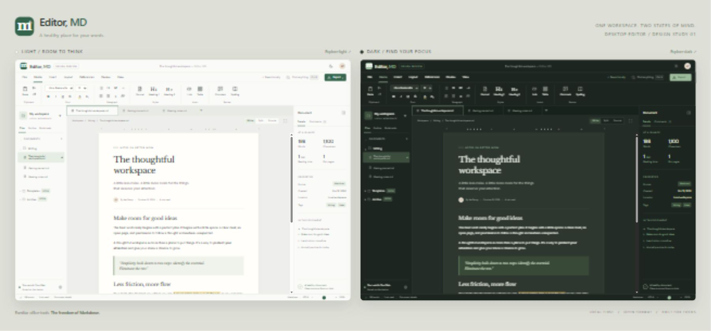

# Editor, MD

**A healthy place for your words.**

A visual and interactive design reference for a future Markdown editor written in Rust. The name plays on MD as both Markdown and doctor. The identity uses a small cross and a calm green palette.

## Preview

Run `npm ci` once, then `npm start` and open **http://127.0.0.1:4173** for the light/dark comparison. Use **Explore light** or **Explore dark** to try the full-size editor.

Mermaid is installed locally so diagram rendering works offline after installation. Google Fonts is optional; system font fallbacks work offline. This preview uses a local server; the final product will be a standalone Windows `.exe` written in Rust, with assets bundled into the application and native file access.

## Try it

- Edit the document directly, or switch between Write, Split, and Source views.
- Switch Page / Web above the document. Page uses fixed paper dimensions; Web reflows across the available editing width. Both layout and Write/Split/Source controls live above the document, independently of the View ribbon. Layout is remembered locally and leaves print settings unchanged.
- Explore the Home, Insert, Layout, References, Review, and View ribbons.
- Apply headings, emphasis, lists, quotes, tables, links, and code blocks.
- Navigate files, create a document, or search document names and content with Ctrl+K.
- Inspect document statistics, jump to headings, and add or resolve preview comments.
- Switch color themes, enter focus mode, and adjust document zoom.
- Customize main and accent colors independently for light and dark mode with the palette button. Light retains the original warm paper/green palette; dark defaults to navy blue/orange.
- Keep the font-size dropdown alongside A− / A+. It follows the selected text, shows Mixed for differing sizes, and reflects inherited point sizes for subscript/superscript. Font family and character formatting states follow the selection too.
- Apply subscript, superscript, font color, or highlighting with distinct character tools (the highlighter uses a marker icon).
- Choose paper size/orientation and individual margins from Layout → Page setup. Defaults are Letter (8.5 × 11 inches), portrait, with 1-inch margins. Returning from Web preserves the document's chosen page setup.
- Create or edit charts in Insert → Graph studio. The spreadsheet-style data grid supports multiple series, row/series insertion/removal, labels, axis titles, and selecting a series for pie charts. Switching chart types preserves the data.
- Build flowcharts with clickable preview nodes, editable labels/shapes, labeled connections, direction controls, and a Decision + Yes / No branches action. The studio includes undo/redo and templates for sequence, Gantt, mind-map, state, class, and entity-relationship diagrams, with source editing for those additional types.
- Use Graph studio → Import data to paste CSV, TSV or a Markdown table. Chart-from-selection and its custom context menu have been removed; the visual chart/flowchart editors and manual import remain available.
- Toggle Autosave file under File. With autosave off, edits remain in memory and the save indicator shows unsaved changes; Save now or Ctrl+S persists them. In this prototype, persistence is browser storage. The future Windows app will autosave actual files.
- Save changes in browser storage with Ctrl+S; export a `.md` copy from Export.

## Scope

This is a **design prototype**, not the Rust application. Its lightweight Markdown conversion supports common structures but does not implement the full CommonMark/GFM specification. Font color and point size export using inline HTML, which some Markdown readers strip (including GitHub styling). Mermaid exports as fenced code blocks; readers need Mermaid support. In-app graph zoom and node selection are editor features, not a promise of portable Markdown interactivity. Arbitrary diagram scripts and callbacks are disabled.

Export offers Markdown, styled HTML with static graph artwork, and PDF through the browser's print interface. Print styling hides application controls and applies document margins independently of screen theme. PDF graphs are static. Some office formatting remains preview-only or HTML/PDF-only. Comments are session-only; templates and archives remain planned features.

The on-screen Page view is a fixed paper preview with scrollable content for long documents. It uses 96 CSS pixels per inch before zoom and retains the selected paper dimensions in Split mode and narrow windows; horizontal scrolling is available when needed. True editable multipage pagination remains native-app work. Browser printing flows the full document rather than clipping it to the screen preview.

See [the design reference](design/DESIGN.md) for layout, colors, behavior, and a proposed native-app feature map.
See [the Writer-inspired feature roadmap](design/FEATURES.md) for the broader office-editor scope and the Markdown/rich document boundary.
See [the Rust agent interface design](design/AGENT-INTERFACE.md) and [proposed MCP tool schemas](design/agent-tools.json) for live-buffer access, revision-checked edits, save/export behavior and desktop integration. These are design artifacts; no MCP server is running in this prototype.

## Files

| File | Purpose |
| --- | --- |
| `compare.html` | Side-by-side light and dark presentation |
| `index.html` | Full-size interactive desktop shell |
| `styles.css` | Layout, responsive behavior, and theme tokens |
| `app.js` | Prototype editing and interface interactions |
| `office.js`, `office.css` | Appearance, font controls, page setup, and export presentation |
| `chart-model.js` | Data import, chart/flowchart model, validation, and portable source round-trip |
| `graph-studio.js`, `editing.css` | Visual graph builder, Page/Web layout, and expanded editing controls |
| `serve.cjs` | Dependency-free local preview server |
| `design/` | Comparison image and implementation reference |

The project has no chosen open-source license yet.

## Validation

`npm run check` checks JavaScript syntax. `npm test` covers data parsing, invalid data, multiple series, branching-flowchart round-trips, safe node deletion, and preserving custom source edits. Browser checks cover selected/mixed font sizes, script formatting, autosave off/manual save, flowchart editing, templates, and Page/Web layout switching independently of editing mode. The Rust MCP contract has no runtime implementation to test yet.
