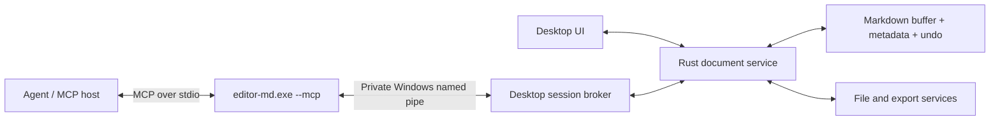

# Editor, MD — Rust agent interface

Status: **proposed native interface**, 2026-10-18. This repository is a browser design prototype. It does not run an MCP server, expose local files to agents, or implement the Rust services described here.

## Decision

Use a local MCP server as an adapter to the same Rust document service used by the desktop UI. Agents should work with the live document buffer, including unsaved changes, through document commands. Editing files behind the application's back or automating toolbar clicks would bypass that state.

The official [Rust MCP SDK (`rmcp`)](https://github.com/modelcontextprotocol/rust-sdk) supports stdio and Tokio. [MCP tools](https://modelcontextprotocol.io/specification/2026-07-28/server/tools) provide discoverable operations with JSON Schema inputs and structured results. These are protocol capabilities; the architecture and editing rules below are Editor, MD design decisions.

Ship one Windows application, provisionally `editor-md.exe`. Normal launch opens the GUI; `editor-md.exe --mcp --profile <profile-id>` runs the stdio adapter. The agent host launches that mode as a child process. Keep protocol messages on stdout and diagnostic logging on stderr. The [MCP server guide](https://modelcontextprotocol.io/docs/develop/build-server) explains this stdio requirement.

Use `rmcp` for protocol negotiation and transport instead of hand-written JSON-RPC. At native implementation time pin a tested SDK release in Cargo.lock and test the negotiated protocol versions against the chosen agent hosts. This design does not assume a host-specific configuration format or prescribe an untested crate version.

## Application structure



The GUI owns one broker per workspace session and one authoritative document service. All writes from the UI and agents enter its serialized command queue. The adapter attaches to the workspace session named by its access profile; it must not guess from the foreground window. If no matching GUI session exists, return `APP_NOT_RUNNING` and ask the host to open the app. Do not silently start a second copy of the same document buffer. Multiple GUI windows for one workspace share that broker; different workspaces have different session identities.

Use a local named pipe with an ACL limited to the current Windows user and reject remote pipe clients. Profile IDs select permissions configured in the GUI; a client-supplied name or command-line workspace path does not grant access. Pipe discovery, profile files, and any handshake secret must use per-user storage and ACLs; secrets must not appear in command-line arguments or logs. Same-user hostile programs remain outside this protection boundary.

Keep these Rust modules independent of the selected UI toolkit:

| Module | Responsibility |
| --- | --- |
| `document` | Canonical Markdown, parsed structure, rich metadata, revisions, selection mapping, undo history |
| `commands` | Validate and execute a command transaction; identical entry point for UI and agent edits |
| `files` | Workspace resolution, encoding/newlines, external-change detection, atomic saves and recovery |
| `export` | Render an immutable document revision using its print settings |
| `agent_broker` | Session attachment, access profiles, command routing, activity records |
| `mcp` | `rmcp` handlers, schema generation, tool results and protocol errors |

Illustrative service boundary, not compiled Rust:

```rust
trait DocumentService {
    async fn snapshot(&self, document: DocumentId) -> Result<DocumentSnapshot>;
    async fn selection(&self, document: DocumentId) -> Result<SelectionSnapshot>;
    async fn apply_edits(&self, command: ApplyEdits) -> Result<EditReceipt>;
    async fn save(&self, command: SaveDocument) -> Result<SaveReceipt>;
    async fn export(&self, command: ExportDocument) -> Result<ExportReceipt>;
}
```

Handlers receive a broker-issued access context in addition to these arguments. Generate transport DTOs with `serde` and schemas with `schemars`; do not let transport handlers access the filesystem or DOM directly. The accompanying [tool catalog](agent-tools.json) is the proposed v1 contract, to be matched by generated schemas when native implementation begins.

## First tool set

Every response carries `api_version: "1"` and `ok`. Success data belongs in `data`; failures contain an error code, message and optional current revision. Tool failures use MCP's tool error result; malformed protocol requests use the SDK's protocol errors. Publish the envelope as `outputSchema`, return it in `structuredContent`, and include a concise text summary. Never return an apparent success after a failed save.

| Tool | Behavior |
| --- | --- |
| `editor_get_state` | List authorized workspace IDs, open document IDs, active document, dirty state and effective permissions. Never list unshared documents. |
| `editor_open_document` | Open an existing workspace-relative `.md` file. Reuse its existing live buffer, preserving unsaved edits. Does not move the user's active tab or caret. |
| `editor_create_document` | Create an unsaved buffer with initial Markdown and a proposed relative path. Fail if that path already exists on disk or in an open buffer. |
| `editor_get_document` | Read Markdown plus revision, disk baseline, dirty state and page settings. Optional byte range supports large documents. |
| `editor_get_selection` | Read selected Markdown ranges and the document revision. Return an empty range list if that document has no mapped selection. Does not change focus. |
| `editor_apply_edits` | Atomically apply a bounded list of replacements against an exact revision; return the new revision and affected ranges. Does not save by itself. |
| `editor_save_document` | Persist an exact revision to its existing/proposed path after checking the disk baseline. Return the actual saved revision and new disk fingerprint. |
| `editor_export_document` | Export a specified revision to a new workspace-relative PDF or HTML file. Use page settings even if the UI is in Web layout. Refuse an existing destination. |

Read tools can be used with a read-only profile. Opening a file requires read access and changes the session's open-buffer list. Creating or applying edits requires buffer-write access; saving requires file-write access; export requires export access. Advertising a tool does not bypass broker authorization. Keep the catalog stable; return an explicit access error when a profile lacks an operation.

## Revision and edit rules

1. A document ID is an opaque live-buffer identity, independent of its filename. Revision strings are opaque and scoped to that ID. Undo, redo, text changes, and persisted metadata changes all produce fresh revisions; revisions are never reused after undo. Layout/theme/zoom are view preferences and do not change a document revision.
2. Internal Markdown uses LF newlines and UTF-8. All offsets are **zero-based UTF-8 byte offsets**, with an exclusive end. Rust must reject boundaries inside a Unicode scalar; never interpret these as JavaScript string indexes. Convert visual selections through a source map. If a rich object cannot be mapped exactly, return `SELECTION_UNAVAILABLE` instead of approximating a range.
3. Each edit supplies `start_byte`, `end_byte`, `expected_text`, and `replacement`. All ranges refer to the same pre-edit snapshot. Validate the complete batch before applying anything. Reject overlaps, duplicate insertion positions, non-boundary offsets and mismatched expected text; apply in descending offset order after validation.
4. `expected_revision` is mandatory on edits, saves and exports. Check it while holding the document transaction lock. A stale request returns `REVISION_CONFLICT` with the current revision and makes no changes. The agent must re-read and recompute its edits; do not automatically rebase or retry a write.
5. One edit batch is one visible undo step, labeled with the agent connection name. Update views from the committed document event, preserving the user's selection through position mapping. Never switch the active tab or move the caret just because an agent edited a document.
6. Mutation requests carry a UUID `request_id`. Cache the result by access-profile ID and request ID for the broker's lifetime. A retry with identical arguments returns its existing receipt without applying again; reuse with different arguments returns `REQUEST_ID_REUSED`. Declare the loss of this cache after an app restart; the host must inspect state before retrying an uncertain mutation.

Read ranges have `start_byte` and `max_bytes` (minimum 4, default 65,536, maximum 262,144). Round the end down to a scalar boundary, return actual start/end, total bytes and `next_start_byte` when more text remains. The four-byte minimum guarantees progress for every UTF-8 scalar. Require `expected_revision` for a nonzero start so subsequent chunks cannot silently mix snapshots. Enforce a 16 MiB document limit, 256 edits per batch, and 1 MiB total replacement data for v1. Return explicit limit errors; never truncate edits. Edit receipts report affected ranges in the resulting revision.

### Example transaction

Starting text is `# Draft\n\nHello.\n`, document ID `doc-7`, revision `r17`. Its selected word `Hello` occupies bytes 9 through 14.

```json
{
  "name": "editor_apply_edits",
  "arguments": {
    "document_id": "doc-7",
    "expected_revision": "r17",
    "request_id": "6f652a9d-8470-40e7-8990-4f0518e20875",
    "edits": [
      {"start_byte": 9, "end_byte": 14, "expected_text": "Hello", "replacement": "Welcome"}
    ]
  }
}
```

Success reports `r18`, `dirty: true` and `saved: false`. This is a tool argument example, not a complete wire message; let `rmcp` supply the envelope required by the negotiated MCP version. A later save must request `r18` and the disk baseline returned by the read. If the user typed in the meantime and the current revision is `r19`, saving `r18` fails instead of saving their newer work without inspection.

## Saving, autosave and export

Keep `revision` (live buffer) separate from `disk_revision` (fingerprint of last observed file bytes, null for a never-saved file). A save must match both `expected_revision` and `expected_disk_revision`. Re-read the disk fingerprint immediately before committing. If the file changed externally, return `DISK_CONFLICT`; keep the buffer and offer the normal user merge/reload flow. There is no force-overwrite flag in v1.

The save service performs a per-document locked transaction, writes a same-directory temporary file, flushes it, and uses the native atomic replacement operation; for a new file use an atomic create-if-absent operation. To close the external-write race on existing files, hold a Windows file handle denying writes/deletes through comparison and commit, or use an equivalent tested native mechanism. If the platform/filesystem cannot provide the required exclusion, fail with `SAVE_CONFLICT` instead of claiming conflict-safe persistence. Preserve encoding and newline convention. Do not clear the dirty flag on I/O failure. Crash-recovery checkpoints remain distinct from saving the user's file.

Agent edits obey the document's Autosave file toggle and the profile's file-write permission. A read/write buffer profile without file-write permission must never trigger autosave to disk; report `autosave_blocked: true` and keep the change dirty. With autosave off, agent edits remain unsaved until an explicit save. With autosave on and file-write permission, enqueue saving the committed revision through the same guarded service; an edit receipt still reports `saved: false` until the save actually completes. Record later save success/failure visibly in the app. The agent can call get_document to inspect the latest disk state.

Rich metadata must use the same canonical document model as the GUI. Decide its durable representation before native save implementation (plain Markdown with an explicit companion file, or a richer project file). Until that decision is implemented, advertise only text edits; do not promise formatting persistence. Export renders a frozen revision and includes page size, margins and static Mermaid artwork. Web/Page layout, UI theme and zoom do not affect PDF output. Recheck revisions before starting; return the exported revision if the user continues editing during rendering. Do not overwrite an output file or open the print dialog for an agent export.

## User-facing agent controls

Add Settings → Agent access to the native app. Default is off. The user can create a named profile, select workspaces, and grant Read, Edit buffers, Save files and Export independently. Provide copyable connection instructions, current connection/activity state, revoke/disconnect, and an activity panel with edit summaries and Undo. Profiles persist only when the user chooses to keep them. Ordinary edits inside a granted scope need no repeated prompt; widening the scope requires a user action in settings.

Canonicalize paths and resolved parent directories, including Windows junctions/symlinks and case-insensitive aliases. Reject absolute paths, traversal, alternate data streams, device paths and escapes outside the selected workspace. For new destinations resolve the existing parent and create atomically without following a late replacement link; keep containment checks attached to the native handles used for I/O. Limit readable input to supported document extensions. Agent operations never execute code, shell commands, Mermaid callbacks, macros or Git pushes. Treat document text as data, including any instructions an agent reads inside it.

## Failure codes

| Code | Agent/user recovery |
| --- | --- |
| `APP_NOT_RUNNING`, `SESSION_UNAVAILABLE` | Open the intended workspace or reconnect to its session. |
| `ACCESS_DENIED`, `PATH_OUTSIDE_WORKSPACE` | Show the denied scope; the user can change a profile in settings. |
| `DOCUMENT_NOT_FOUND`, `PATH_EXISTS` | Refresh state or choose a new path. |
| `REVISION_CONFLICT`, `TEXT_MISMATCH` | Re-read and recompute the edit against the current document. |
| `INVALID_RANGE`, `OVERLAPPING_EDITS`, `LIMIT_EXCEEDED` | Fix the request; nothing was applied. |
| `SELECTION_UNAVAILABLE` | Read Markdown and target explicit source ranges. |
| `DISK_CONFLICT`, `SAVE_CONFLICT`, `IO_ERROR` | Preserve the dirty buffer and report the actual failure. |
| `REQUEST_ID_REUSED` | Use a new ID for a different operation. |
| `UNSUPPORTED_FORMAT`, `EXPORT_FAILED` | Use a supported output or surface rendering diagnostics. |

## Native implementation milestones

1. Implement document snapshots, UTF-8 ranges, command queue, undo, source mapping and disk conflict handling without MCP. Resolve metadata storage first.
2. Add broker/profile settings and read-only MCP tools. Test discovery, stdio cleanliness and disconnects with a real host.
3. Enable create/edit/save after concurrency, idempotency, autosave and path-boundary tests pass. Test a user typing between an agent read and write, two agents on one revision, emoji/combining marks, undo after an agent edit, external file changes, junction escapes, failed writes and retries after a lost response.
4. Add native PDF/HTML export after output fidelity is validated. Test Web layout still exports paper margins, graph output stays static, revision receipts match the snapshot and existing outputs cannot be overwritten.

The browser prototype remains a visual reference. These milestones belong to the future Rust application; none is marked implemented by this document.
